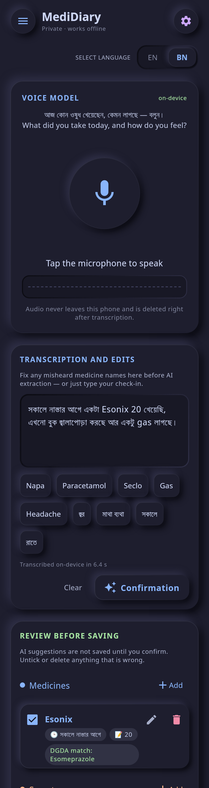
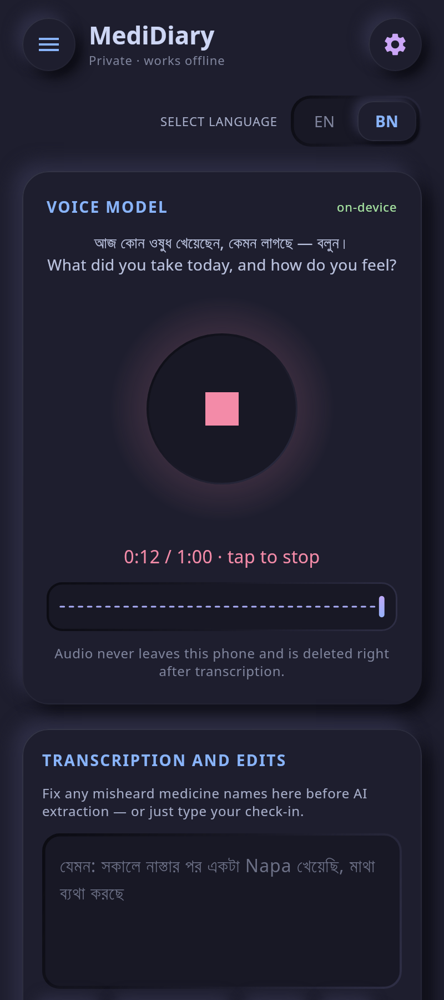
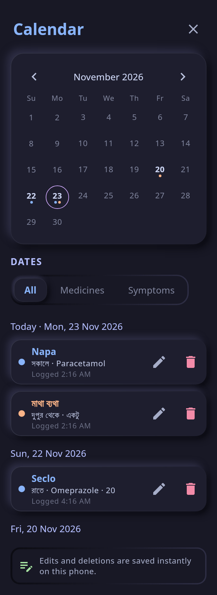
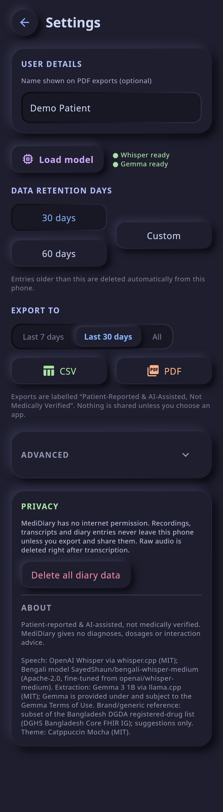

# MediDiary

An offline, bilingual (Bangla + English) Android health diary. Speak a short daily check-in. On-device
Whisper transcribes it, you correct the text, and an on-device fine-tuned Gemma 3 1B proposes medicine and
symptom records. You verify every record before it is saved, then review a timeline and export PDF or CSV
for your clinician.

> **Patient-Reported & AI-Assisted, Not Medically Verified.** MediDiary is a record-keeping aid. It does not
> give diagnoses, dosages or interaction advice.

The full engineering spec is in [`claude.md`](claude.md).

## Guarantees

| Rule | Where it's enforced |
|---|---|
| Zero cloud: no `INTERNET` permission, works in airplane mode | `app/src/main/AndroidManifest.xml` (also strips any merged network permission) |
| Human-in-the-loop: AI never auto-saves | `CheckInViewModel` keeps proposals in memory; `DiaryRepository.saveVerified` is called only from **Confirm & Save** |
| Deterministic generics: the LLM never supplies generic names | `ModelResponseParser` discards `generic_suggestion`; `DgdaMatcher` fills it from the local DGDA table |
| Sequential RAM: Whisper and Gemma are never loaded together | `InferencePipeline` mutex; each JNI call loads, runs and frees its model |
| Raw audio deleted after transcription | `CheckInViewModel.stopAndTranscribe`, plus a startup sweep in `MediDiaryApp` |
| No cloud backup of health data | `allowBackup=false` + `data_extraction_rules.xml` / `backup_rules.xml` |

## Design

The UI follows the team wireframe and uses the **Catppuccin Mocha** palette with **neumorphic** (soft-UI) controls:

- **Main screen:** ☰ **Calendar** panel (month grid, dates, edit/delete saved entries), ⚙ **Settings**, **EN | BN** speech
  language toggle, a **VOICE MODEL** card (mic, timer, level meter) and a **TRANSCRIPTION AND EDITS** card. Its
  **Confirmation** button runs the on-device extraction. The proposed medicines and symptoms then appear as review cards,
  and nothing is saved until **Confirm & Save**.
- **Settings window:** User details · Load model · Data retention days (30 / 60 / Custom) · Export to CSV / PDF ·
  Advanced · Privacy · About.
- On tablets and in landscape (≥ 840 dp) the Calendar is a permanent left panel, as in the wireframe.


| Home (review) | Recording | Calendar | Settings |
|---|---|---|---|
|  |  |  |  |

Tablet / landscape: [`docs/screenshots/home_tablet.png`](docs/screenshots/home_tablet.png). These images are rendered
from the Compose preview functions with fictional sample data.

## Project layout

```
app/                      Kotlin + Jetpack Compose app (com.medidiary.app)
  ai/                     WhisperEngine / GemmaEngine (native + mock), ModelManager, InferencePipeline
  audio/                  16 kHz mono PCM WAV recorder
  data/db/                Room entities + DAOs (diary_sessions, diary_records, dgda_medicines, dgda_aliases)
  data/dgda/              DGDA seeder + deterministic brand→generic matcher
  domain/                 ModelResponseParser, ExtractionSanitizer, system prompt
  export/                 PdfReportGenerator (android.graphics.pdf), CsvExporter, FileProvider sharing
  ui/home/                Main screen: Voice model, Transcription and edits, review cards
  ui/diary/               Calendar side panel (month grid + dates + edit/delete)
  ui/settings/            Settings window: user details, load model, retention, export
  ui/theme/, components/  Catppuccin Mocha palette + neumorphism kit
  work/                   30/60-day retention worker
  src/main/assets/dgda/   DGDA reference CSVs (review before release, see below)
whisper/                  JNI module: whisper.cpp → libmedidiary_whisper.so
llama/                    JNI module: llama.cpp → libmedidiary_llama.so
third_party/              git submodules, pinned: whisper.cpp v1.9.5, llama.cpp b12621
```

Each native module statically links its own copy of ggml and hides those symbols (`--exclude-libs,ALL`), so
whisper.cpp and llama.cpp never clash.

## Build

[](https://github.com/aaaaaaa00n/MediDiary/actions/workflows/android-apk.yml)

**Ready-made APKs:** every push builds one in GitHub Actions (*Actions → Android APK → Artifacts*). Tagging `v1.0.0`
publishes it as a GitHub Release. The workflow fails if the APK ever gains a network permission. For a fixed signing key
(so CI builds update each other on the demo phone), add the repository secrets `MEDIDIARY_KEYSTORE_BASE64`,
`MEDIDIARY_KEYSTORE_PASSWORD`, `MEDIDIARY_KEY_ALIAS` and `MEDIDIARY_KEY_PASSWORD`.

Requirements: Android Studio (Ladybug or newer), JDK 17, **NDK 27.2.12479018**, CMake 3.22.1 (install both from
SDK Manager → SDK Tools).

```bash
git clone --recurse-submodules <repo-url>
# or, in an existing clone:
git submodule update --init --recursive
./gradlew :app:assembleDebug
```

The first native build compiles whisper.cpp and llama.cpp and takes several minutes. Only `arm64-v8a` is built.


## Model files (custom fine-tuned Whisper + Gemma)


| File name on device | Format | How to produce it |
|---|---|---|
| `medidiary-whisper.bin` | whisper.cpp **ggml** | Hugging Face fine-tune → `python third_party/whisper.cpp/models/convert-h5-to-ggml.py <hf_model_dir> <clone of github.com/openai/whisper> <out_dir>`. Optionally quantise with `whisper-quantize ggml-model.bin out.bin q5_0`. |
| `medidiary-gemma.gguf` | **GGUF**, Q4_K_M | Merge LoRA into the base model if needed, then `python third_party/llama.cpp/convert_hf_to_gguf.py <merged_dir> --outtype f16 --outfile gemma-f16.gguf` and `llama-quantize gemma-f16.gguf gemma-3-1b-it.Q4_K_M.gguf Q4_K_M`. |

You can install them in either of two ways. Neither uses the network.

1. **adb (fastest during development).** Install and launch the app once, then:
   ```bash
   adb push ggml-medidiary-whisper.bin /sdcard/Android/data/com.medidiary.app/files/models/medidiary-whisper.bin
   ```
   ```bash
   adb push gemma-3-1b-it.Q4_K_M.gguf /sdcard/Android/data/com.medidiary.app/files/models/medidiary-gemma.gguf
   ```
   Then go to **Settings → Load model → Re-scan**.
2. **In the app.** Copy the files to the phone (Downloads, USB, SD card), then use **Settings → Load model → Import…**. The
   app checks the file header (GGUF / ggml) before accepting it.


## Training notebooks (`training/`)

Both notebooks run in Google Colab.

| Notebook | Purpose |
|---|---|
| `gemma3_medidiary_v2.ipynb` | Re-trains the Gemma 3 1B extractor for better **symptom recall**. It adds about 1,000 synthetic multi-symptom check-ins (labelled so that `name` = the words as spoken), turns packing off, and adds negation and planned-medicine negatives. It reports strict and lenient P/R/F1, re-checks the **quantised GGUF with llama.cpp** using the app's exact prompt, and saves `medidiary-gemma.gguf` to Drive. |
| `whisper_bengali_setup.ipynb` | Sets up the speech model [SayedShaun/bengali-whisper-medium-ggml](https://huggingface.co/SayedShaun/bengali-whisper-medium-ggml), which is already ggml so no conversion is needed. It downloads q6_k and q4_0, checks them with the **same whisper.cpp version as the app** (v1.9.5), compares CER and speed on your own Bangla clips, and saves the chosen file as `medidiary-whisper.bin`. |

## References & acknowledgements

1. OpenAI Whisper (MIT). Speech model: [SayedShaun/bengali-whisper-medium-ggml](https://huggingface.co/SayedShaun/bengali-whisper-medium-ggml) (Apache-2.0), a whisper.cpp conversion of SayedShaun/bengali-whisper-medium, fine-tuned from openai/whisper-medium.
2. whisper.cpp and its Android example (MIT).
3. Gemma 3 1B. Gemma is provided under and subject to the Gemma Terms of Use (ai.google.dev/gemma/terms).
4. llama.cpp and its Android integration (MIT).
5. Android Developers: Room and app data storage.
6. Bangladesh DGHS, Bangladesh Core FHIR Implementation Guide: DGDA Registered Drugs value set. The brand/generic
   subset is used as a reference for suggestions only.
7. Android Developers: Auto Backup and sensitive data controls.
8. Catppuccin colour palette (MIT), https://github.com/catppuccin/catppuccin.
